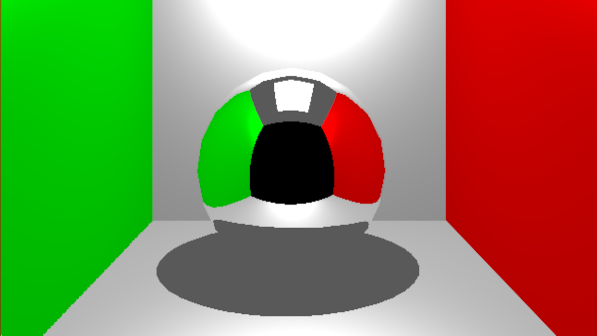
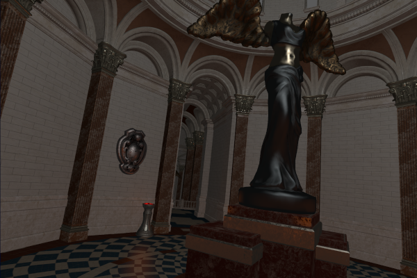

# About Me
 
Hiya! Nice to see you here!

I am Tej. I am currently in my my final year of MEng BSc Computer Science with High Performance Graphics and Games Engineering. I have an interest in High Performance C/C++ Programming and Modern Graphics and rendering systems. I also am interested in computer arithmetics, especially floating point accuracies and inconsistencies.

   
# Projects

{: .text-right}

## Axiom Swerve, a vehicular bullet hell game

<video controls autoplay muted loop style="max-width: 100%; height: auto;">
    <source src="/assets/videos/axiom_swerve.mp4" type="video/mp4" >
</video>

I made a game with a friend using our own game engine. We wanted to have a very stylised and stumulating experience that has no wait time. Axiom swerve came to be with powerups that initiate screen space effects and different drum and bass sound effects with every action you can take. The idea was to make every moment of the game fun, keeping the player interested in not only the objectives but also the in visual effects.

I was very inspired my the cyberpunk aesthetic and bullet hells that make every moment worth while.

 

## Ubiquitous Reality, a game engine for style.

<video controls autoplay muted loop style="max-width: 100%; height: auto;">
    <source src="/assets/videos/ubqr.mp4" type="video/mp4" >
</video>

I started with the idea of complex rendering effects and object specific rendering, and wanted to make a game engine that allows me to use effects with gameplay seemlessly. After a couple conversations, a random word-generator, and a simple vulkan renderer later, I started this project with a small group aiming to get a simple racing game loop possible as test.

We then went on to create our own ECS from scratch, our own Vulkan loader and pipeline creator and our own event system. I took ownership of the renderer as I have developed a good skillset with Vulkan and I had ideas to improve the pipelines and also add special effects.

The poster goes into a lot of details but a video should be up very soon.

 

{: .text-right}

## Raytracer with Optical Physics

<!-- {: .align-left .img-small} -->

  

    
    
    

    <button class="nav-button left" onclick="prevImage()">❮</button>
    <button class="nav-button right" onclick="nextImage()">❯</button>
  

This project involved making a raytracer to implement different optical effects such as reflections and shadows.
I started off with first making the OpenGL rendering half of the window, which simply renders a given obj file with material properties provided. This implements simple Phong shading without shadows or reflections etc.

The next step invloved implementing primary rays, intersection testing, barycentric interpolation and material color representation and implementing Blinn-Phong on the CPU. Calculating whether a point is in shadow is done after the first intersection. We send a ray for the intersection point to the light source and test wether we intersect the light source or not. If the light source is occluded, the lighting calculation is done using only ambient and emissice colour if the triangle is in shadow. This procedure also required displacement of ray positions to minimize shadow acne.

Implementing reflections required using recursions of rays where each ray is reflected and tested to see what it intersects with. Doing is step N number of times accounting for energy loss after every bounce.

Then I went on to implement refraction using Snell's Law and Fresnal Equations (Schlick's Approximation). Total internal reflection was accounted for using angles of refraction. I alos implemented Beer's law to incorporate transparency with colour.

 

## Vulkan Renderer

<!-- {: .align-right .img-small} -->

<video muted playinline autoplay loop style="max-width: 100%; height: auto;">
    <source src="/assets/videos/vulkan.mp4" type="video/mp4">
</video>

This project was my first major project in Vulkan, incorporating different rendering techniques that I can toggle. Setting up involved all Vulkan rendering infrastucture for a real-time rendering application, including creating a Vulkan instance, validation layers, renderable window, selecting and creating logical device, a swap chain, and framebuffers, etc.

I also implemented navigation and camera camera controls using GLFW's event driven framework with callbacks and polling.

Next step was to implement simple diffuse/base color renderer to simply render the texture of each mesh in the scene. To help with the next steps, I implemented different debug visualisation pipelines for texture mipmap levels, normals, fragment depth, and partial derivatives of depth.

Finally, implementing PBR shading, I first implemented uniform buffers and descriptor sets to get all relevent data to the fragment shader. I chose to implement the Cook-Torrence BRDF model for shading, where I implemented the Beckmann NDF, and Fresnel tern using Schlick's Approximation along with Lambertian Diffuse. Alpha masking is done using a separate pipeline to ensure all object with transparency are rendered last.

I also implement a simple render-to-texture post-processing filter to pixalate the output in a 5 &times; 3 texel. This step imvolved synchronisation precautions using subpass dependencies and image transitions.

I wanted to implement deferred shading next, as a result I first created a debug visualisation to view mesh overdraw and over-shading. Next, to implement deferred shading, I created a new pipeline and renderpass with 4 attachments: depth, normals, albedo + metalness (as the 4th channel) and emissive + roughness (as the 4th channel). In the next stage I use these to perform lightimng calculation only on the visible objects in the scene, reducing over-shading and improving total lighting calutation times.

 

{: .text-right}

## Animation and Collision Physics

<video controls autoplay muted loop style="max-width: 100%; height: auto;">
    <source src="/assets/videos/animation_collision.mp4" type="video/mp4">
</video>

A project implementing animation across different surfaces and collision physics. This had two main parts, first being the rendering of the skeletal charactor and applying rotation based animations per frame to run. To improve the sudden stopping and running
I implemented interpolation to blend poses to start running slowly to look realistic and same with stopping.

The second part was to implement a simple collision systems for the balls/dodecahedrons. This involved collision testing with the character and the land surface and calculating impulse and direction to bounce the balls. For dodecahedrons I also implemented
angular velocity calculations to have realistic bounces.

 

{: .text-left}

## Mesh Pocessing and Repair

<video controls autoplay muted loop style="max-width: 100%; height: auto;">
    <source src="/assets/videos/hamishslow.mp4" type="video/mp4">
</video>

A project involving mesh processing where I implemented several different command line tools, including, triangle soup parser to convert to indexed face and further to directed edge. Manifold testing for meshes, testing for pinch points and intersections. Mesh repair and simplification as well.

 

{: .text-right}

## Bézier Curve Calculator and Visualiser

<video controls autoplay muted loop style="max-width: 100%; height: auto + 10px; padding-bottom: 10px">
    <source src="/assets/videos/bezier.mp4" type="video/mp4">
</video>

A Bézier curve visualiser developed from scratch where I started off with a function to set the colour of one pixel. Using that I created line drawing algorithms and drew the axes and axial planes. Using rotation matrices I also apply transformations to the axes and planes. The matrices are calculated depending on orthographic or perspective projection.

Next I created the control net using the control points of the bezier curve that start at the predefined positions. I also implemented a simple sphere drawing algorithm to render the control points.

The Bézier curve positions themselves are calculated using <a href="https://en.wikipedia.org/wiki/De_Casteljau%27s_algorithm" target="_blank" rel="noopener noreferrer">de Casteljau</a> algorithm setting the colours with <math>(s, t)</math> modulating the red and blue colour channels.

 

{: .text-left}

## Spaceship Demo in OpenGL

<video controls autoplay muted loop style="max-width: 100%; height: auto;">
    <source src="/assets/videos/rocket.mp4" type="video/mp4">
</video>

Computer Graphics project in OpenGL.

<!-- 

  

    
    
    

    <button class="nav-button left" onclick="prevImage()">❮</button>
    <button class="nav-button right" onclick="nextImage()">❯</button>
  

 -->

