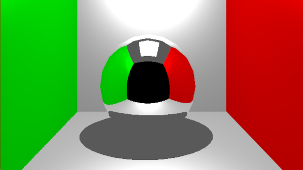
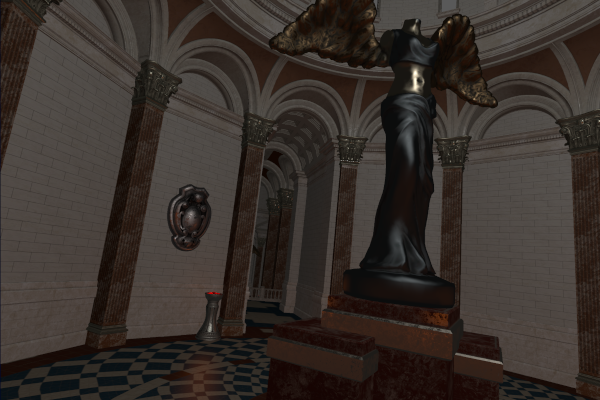

These are some of my project I have had the pleasure developing.
Currently I only showcase the project that involve graphics and/or rendering as
they usually are accompanied with some images and media that is easier to showcase.
In the future I am hoping to also show projects that are more terminal based or are
purely libraries.

{: .text-right}

## Axiom Swerve, a vehicular bullet hell game

<video controls autoplay muted loop style="max-width: 100%; height: auto;">
    <source src="/assets/videos/axiom_swerve.mp4" type="video/mp4" >
</video>

I made a game with a friend using our own game engine. We wanted to have a very stylised and stumulating experience that has no wait time. Axiom swerve came to be with powerups that initiate screen space effects and different drum and bass sound effects with every action you can take. The idea was to make every moment of the game fun, keeping the player interested in not only the objectives but also the in visual effects.

I was very inspired my the cyberpunk aesthetic and bullet hells that make every moment worth while.

 

## Ubiquitous Reality, a game engine for style.

<video controls autoplay muted loop style="max-width: 100%; height: auto;">
    <source src="/assets/videos/ubqr.mp4" type="video/mp4" >
</video>

I started with the idea of complex rendering effects and object specific rendering, and wanted to make a game engine that allows me to use effects with gameplay seemlessly. After a couple conversations, a random word-generator, and a simple vulkan renderer later, I started this project with a small group aiming to get a simple racing game loop possible as test.

We then went on to create our own ECS from scratch, our own Vulkan loader and pipeline creator and our own event system. I took ownership of the renderer as I have developed a good skillset with Vulkan and I had ideas to improve the pipelines and also add special effects.

The poster goes into a lot of details but a video should be up very soon.

 

{: .text-right}

## Raytracer with Optical Physics

{: .align-left .img-small}

This project involved making a raytracer to implement different optical effects such as reflectiona and shadows.
I started off with first making the OpenGL rendering half of the window, which simply renders a given obj file with material properties provided. This implemnets simple blinn phong without shadows or reflections etc.

The next step invloved implementing primary rays, intersection testing, and material color representation. Further implementing Blinn-Phong on the CPU and then implemened the shadow calculation logic.
Then implementing reflections as you can see in the image, using recursions of rays. Then I went on to implement refraction using Snell's Law and Fresnal Equations (Schlick's Approximation).

 

## Vulkan Renderer

{: .align-right .img-small}

This project was my first major project in Vulkan, incorporating different rendering techniques that I can toggle. First I implemented simple forward shading with alpha masking, where the material properties as descriptor sets to calculate BRDF lighting in the shaders.
Secondly, I implemented a second pipeline and renderpass to implement render-to-texture and post processing pixellation/mosaic effect. This task help me understand renderpasses and rendering to images which I used in the next rendering technique: Deferred Shading.
Implemening deferred shading involved creating G-Buffer where I output the normals, albedo texture, depth and emissive texture images and include the other materials in the alpha values of these images to reduce bandwidth costs. In a second render pass, I calculate fragment positions
using pixel positions and depth value and implement the BRDF shading with multiple light sources. This is the render that is shown in the image with the inverse square light falloff also implemented.

<!--   -->

{: .text-right}

## Animation and Collision Physics

<video controls autoplay muted loop style="max-width: 100%; height: auto;">
    <source src="/assets/videos/animation_collision.mp4" type="video/mp4">
</video>

A project implementing animation across different surfaces and collision physics. This had two main parts, first being the rendering of the skeletal charactor and applying rotation based animations per frame to run. To improve the sudden stopping and running
I implemented interpolation to blend poses to start running slowly to look realistic and same with stopping.

The second part was to implement a simple collision systems for the balls/dodecahedrons. This involved collision testing with the character and the land surface and calculating impulse and direction to bounce the balls. For dodecahedrons I also implemented
angular velocity calculations to have realistic bounces.
